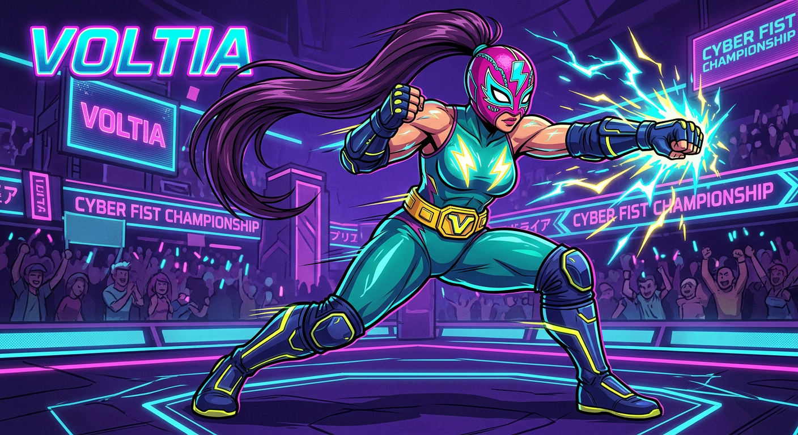

# FabaterFighter

Juego de peleas 2D. Personajes jugables: **VOLTIA** (la luchadora voltaje ⚡) y **CHUN-LI**.



## Arrancar

```bash
pip install -r tools/requirements.txt        # Pillow, solo para los scripts
python3 tools/serve.py                       # http://localhost:8080
```

`tools/serve.py` sirve el repositorio con **`Cache-Control: no-store`**: el visor cambia
mucho y el navegador cacheando HTML/PNG ya nos costó tres veces «los cambios no llegan».

- `/` → menú principal con accesos a Juego, Creador de personajes y Personajes.
- `/preview/fight.html` → juego de pelea con selector de personajes, cajas de golpe con **H** y modo de pantalla completa.
- `/creator/` → interfaz del creador; `/preview/nuevo.html` queda como enlace de compatibilidad.
- `/creator/pruebas-ia/` → visor aislado para revisar recortes y fondo de nuevas hojas IA; no escribe en el creador ni en los datos del juego.
- `/preview/personajes.html` → plantel de Voltia original, Voltia Final y Chun-Li; su lista está en
  `characters/roster.json`.
- `/preview/voltia-final.html` → visor independiente de las animaciones aprobadas y publicadas desde el Creador.
  La publicación requiere revisar cabeza, suelo y posición del sprite por movimiento; el desplazamiento se aplica al visor sin alterar los PNG.
- `/preview/index.html` → visor de Voltia original: frames, tira, fondos y manual de movimientos.
- `/preview/chunli.html` → ficha de Chun-Li: las 22 animaciones.
- `/preview/guia-vieja.html` → guía de estilo original de Voltia.

En el creador se pueden cambiar los perfiles Voltia/Chun-Li, subir PNG individuales o cortar
hojas/tiras por una rejilla de celdas exactas. Por defecto solo se importa una fila para no
mezclar movimientos; los frames aceptados quedan **pendientes**. «Guardar animación» descarga
a tu equipo la tira PNG y el manifiesto JSON, sin modificar el sprite.

## Organización del código y los datos

- `creator/` contiene la interfaz; `tools/serve.py` y `tools/creator_store.py` contienen el servidor y las operaciones.
- `characters/roster.json` es el registro de presentación y contiene perfiles independientes de datos para Voltia y Chun-Li; el creador permite cambiar entre ellos. Los retratos están en `characters/<id>/`.
- `preview/fight.js` es el motor; `preview/chars/` contiene solo las fichas de combate.
- Las hojas históricas siguen en sus rutas de Voltia/Chun-Li para no duplicar ni alterar fuentes originales. Las nuevas subidas de Chun-Li van a `characters/chunli/creator/`, fuera del árbol de Voltia.

## Voltia: lo que se sirve

| | |
|---|---|
| hoja | `voltia/sheet_uniform.png` (5250 × 8300, 15 × 25 celdas de 350 × 332) |
| datos | `voltia/sheet.json` (fila, frames, fps, loop, `rev` = md5 de la hoja) |
| ajustes | `rev` obliga al navegador a pedir la hoja nueva; `pivot` y `scale` los manda `sheet.json` |
| fuente | `voltia/frames/voltia_<anim>_<n>.png`, **rejilla de píxel exacta de 4×** |
| animaciones | **25** · **102** frames |

El modelo oficial es **el dibujo nativo tal cual**: borde verde, **0 filtros de
reconstrucción**. No se limpia el grano, no se erosiona el contorno, no se rellena la
silueta. Cualquier filtro que se aplique después inventa píxeles y borra dibujo (el brillo del
ojo, la punta de la coleta): por eso se quitaron.
La hoja se genera entera con:

```bash
python3 tools/voltia_reconstruir.py            # hoja + sheet.json + fighter del escenario
python3 tools/voltia_reconstruir.py --solo-ver # solo comparaciones, no escribe
```

Pipeline, por frame: `÷4 NEAREST` a 1× de arte → `×2 NEAREST` a la hoja, pegado alineado a
par. Nada más. Los frames nativos son un ×4 exacto (0,00 % de bloques 4×4 no uniformes), así
que ÷4 recupera el píxel original: los 102 frames de la hoja son **idénticos píxel a píxel**
al nativo (comprobado, 0 diferencias visibles).

Los filtros siguen en el código detrás de `--filtros 1` solo para comparar; no son el modelo.

> **Regla que no se negocia:** al pixel art **nunca** se le aplica un reescalado con
> interpolación (LANCZOS/BILINEAR) ni un factor fraccionario. Eso inventa medios píxeles,
> y de ahí salieron el 52 % de bloques 2×2 sucios, los cuadrados sueltos y el morado de la
> cara. Si hay que cambiar de rejilla, se baja con NEAREST a un divisor entero.

## Chun-Li

Personaje completo en el motor, con la misma altura que Voltia (147 px de mundo).

| | |
|---|---|
| filas de origen | 24, pero **1–3 son el mismo stance** → **22 animaciones** |
| stance | un solo bucle `1 → 2 → 1 → 3`, 32 frames a 10 fps = 3,2 s |
| hoja del juego | `voltia/nuevo/chunli/game/sheet.png` + `sheet.json` (celda 284 × 223, pivote 141,196) |
| regenerar | `tools/chunli_rows.py` → `tools/chunli_sheet_game.py` → `tools/chunli_page.py` |

## Herramientas

| script | para qué |
|---|---|
| `tools/serve.py` | servidor local sin caché |
| `tools/voltia_reconstruir.py` | hoja oficial de Voltia desde los frames nativos |
| `tools/make_gif.py` | GIF desde una carpeta de frames |
| `tools/chunli_rows.py` | corta las 24 filas y monta las 22 animaciones de Chun-Li |
| `tools/chunli_sheet_game.py` | hoja de juego (altura, pivote, celda) |
| `tools/chunli_page.py` | genera `preview/chunli.html` |
| `tools/chunli_hoja.py` | hoja de referencia: una fila por animación |
| `tools/chunli_hitboxes.py` | cajas de golpe |

Generación del arte (Voltia): `voltia/build_sheet.py` + `voltia/normalize.py`
(`python3 voltia/analyze.py --freeze` congela el canon en `spec.json`). Ambos usan ya
**solo NEAREST**: el LANCZOS que ensuciaba las hojas está eliminado.
